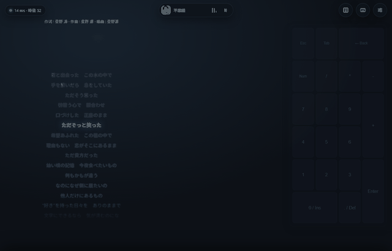
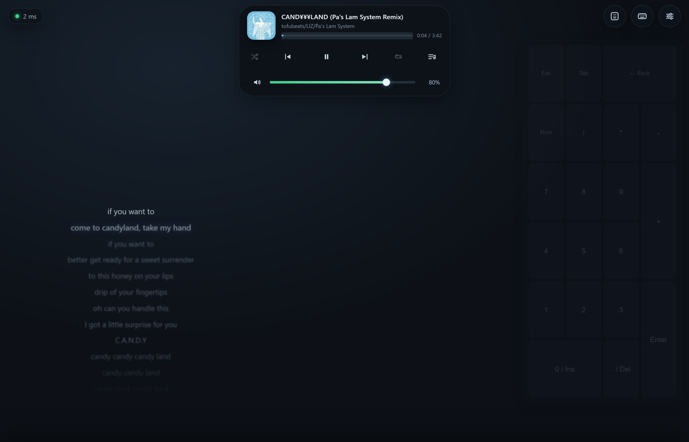
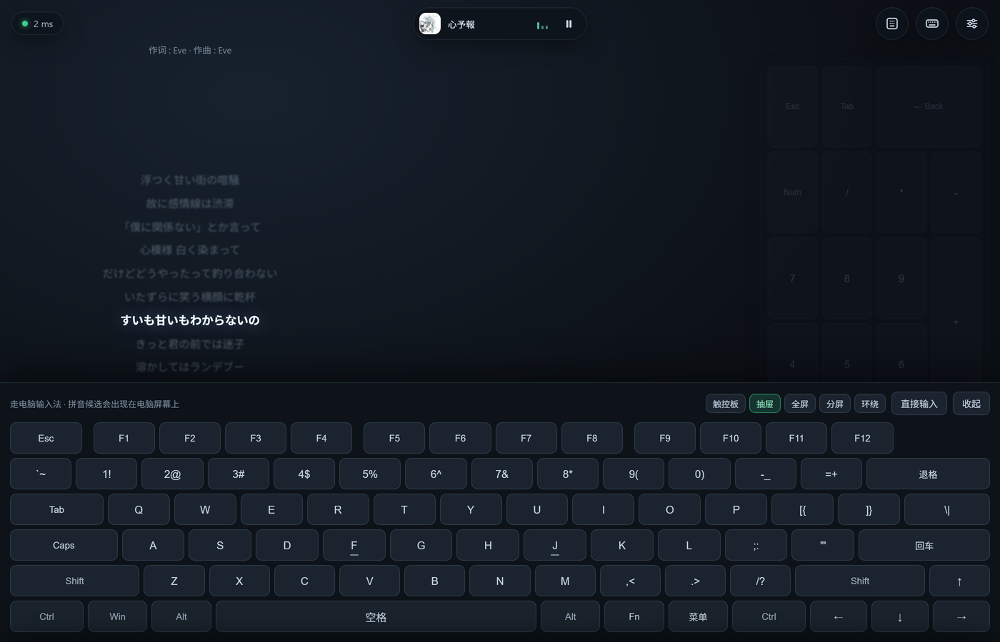
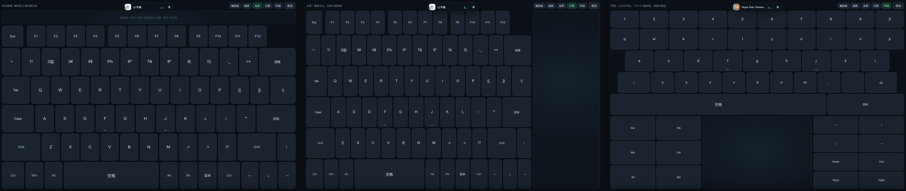
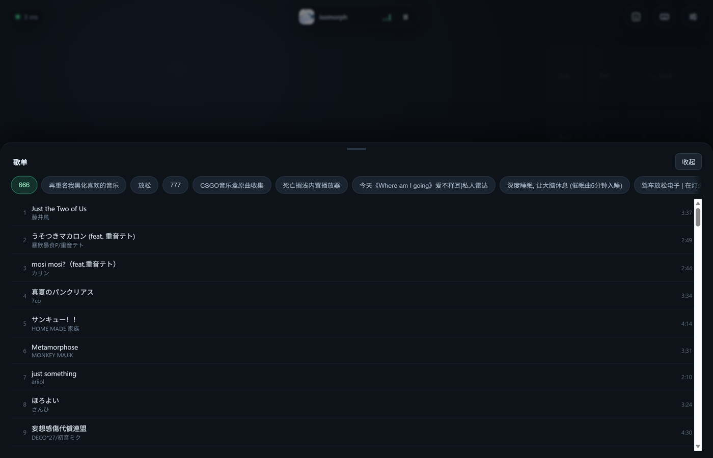
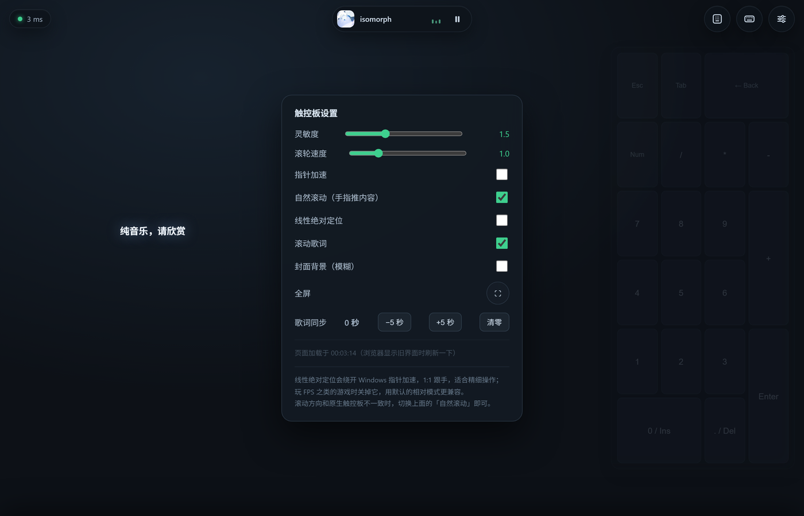

# PadTrack

把安卓平板变成 Windows 的触控板 + 键盘 —— 平板**不用装 App、不用 root**，浏览器打开网页即可。




PC 端跑一个纯标准库的 Python 脚本，平板用浏览器连上，手指在网页上滑动就驱动电脑光标。
带宽占用极小，同一 WiFi 下延迟约 10–30ms。

> 上面这段动画是四种键盘形态的切换：触控板 → 抽屉 → 全屏 → 分屏 → 环绕。

## 界面



左侧滚动歌词、中间媒体胶囊、右侧常驻九宫格；整块歌词层是 `pointer-events: none`，
在上面滑动仍然是在操作触控板。

## 特性

- **零依赖**：只用 Python 标准库，不装任何第三方包
- **平板零安装**：Chrome / Edge 打开网页即用，不用 APK
- **手势对齐 Windows 精密触控板**：单指移动、双指滚动（带惯性）、捏合缩放、三指切换窗口
- **走电脑输入法**：网页自绘键盘只发按键，拼音候选框出现在电脑上，用的还是你熟悉的词库
- **四种键盘形态**：抽屉 / 全屏（滑动当触控板）/ 分屏 / 环绕
- **媒体胶囊**：歌名/封面/播放控制、可拖进度条、歌单浏览、随机与循环
- **系统音量**：展开胶囊后可拖滑块调音量、一键静音，和电脑音量实时同步
- **歌词两件套**：左侧滚动歌词 + 全屏模糊封面背景，都能单独关掉
- **可调手感**：灵敏度、滚轮速度、指针加速、滚动方向、绝对定位
- **访问码保护**：同一网段的其他设备不能随便连

## 键盘形态



抽屉 / 全屏 / 分屏 / 环绕四种形态，每种顶部都有切换条，不用退回主界面：



## 歌单与设置





## 下载

到 [Releases](releases/latest) 下载 `PadTrack.zip`，解压后双击 `PadTrack.exe`，**不需要安装 Python**。

从源码运行：

```bash
git clone https://github.com/zcmwhh/padtrack.git
cd padtrack
python server.py
```

## 快速开始

1. 双击 `PadTrack.exe`（或 `python server.py`），窗口里会打印：

   ```
   平板浏览器打开:  http://192.168.1.10:8765/?k=4821
   ```

2. 平板连**同一个 WiFi**，浏览器打开这个地址（`?k=` 是访问码）
3. 手指在平板上滑动，电脑光标跟着动

首次运行 Windows 会弹防火墙提示，务必勾选**专用网络**。若误点了阻止，用管理员 CMD 补一条：

```bat
netsh advfirewall firewall add rule name="PadTrack" dir=in action=allow protocol=TCP localport=8765
```

## 手势

| 操作 | 效果 |
|---|---|
| 单指滑动 | 移动光标 |
| 轻点 | 左键单击 |
| 双击后直接拖 | 拖拽（0.3 秒内第二下、落点相差 8px 以内、停稳 0.08 秒后再移动 14px 才开拖） |
| 按住 0.3 秒后拖动 | 拖拽（备选方式） |
| 双指上下滑 | 滚动，松手带惯性衰减 |
| 双指左右滑 | 横向滚动 |
| 双指捏合 / 张开 | 缩放（Ctrl+滚轮） |
| 双指轻点 | 右键 |
| 三指轻点 | 开始菜单 |
| 三指上滑 / 下滑 | 任务视图 / 显示桌面 |
| 三指左右滑 | 切换窗口（Alt+Tab） |

## 键盘

| 形态 | 布局 | 适合 |
|---|---|---|
| 抽屉键盘 | 屏幕下半，完整 104 键 | 偶尔打字 |
| 全屏键盘 | 铺满全屏，顶部有触控条 | 大量打字 + 随时移光标 |
| 分屏 | 左 3/4 键盘 + 右 1/4 触控板 | 边打字边点选 |
| 环绕 | 上方 5 行标准键盘（`~ / Tab / Caps / Shift / Ctrl 行完整）+ 下方 3:2 触控板 + 两侧功能区（Esc·Del·Insert / 方向键·Home·End·PgUp·PgDn） | 长时间打字 |

**每种键盘顶部都有形态切换条**（触控板 / 抽屉 / 全屏 / 分屏 / 环绕），在哪个模式里都能直接跳转，
不用退回主界面。**右上角的键盘按钮会记住你上次用的形态**——用过全屏，下次点它直接就是全屏，
再点一下收回。也可以直接用网址进入某个形态，方便收藏：

```
http://192.168.1.10:8765/?k=4821&mode=drawer     # 抽屉
http://192.168.1.10:8765/?k=4821&mode=full       # 全屏
http://192.168.1.10:8765/?k=4821&mode=split      # 分屏
http://192.168.1.10:8765/?k=4821&mode=surround   # 环绕
```

### 键位

抽屉 / 全屏 / 分屏三种形态使用**完整 104 键布局**，和电脑键盘一一对应：

```
Esc  F1 F2 F3 F4  F5 F6 F7 F8  F9 F10 F11 F12
`~   1! 2@ 3# 4$ 5% 6^ 7& 8* 9( 0) -_ =+        退格
Tab  Q W E R T Y U I O P  [{ ]} \|
Caps  A S D F G H J K L  ;: '"                  回车
Shift  Z X C V B N M ,< .> /?            Shift   ↑
Ctrl  Win  Alt  [    空格    ]  Alt  Fn  菜单  Ctrl ← ↓ →
```

- **F 和 J 键下方有横杆**（和实体键盘的定位凸起一样），盲打时手指有参照点；
- **左 Shift 双击锁定**：0.3 秒内连点两下左 Shift 就锁住，之后每个字母都带 Shift，
  键面右上角出现小锁图标；再点一下解锁（右 Shift 不参与，避免误触）
- **Caps 键字母下方有小白灯**：**按下立刻亮、再按立刻灭**（本地先切，不等网络）；
  之后每 3 秒和电脑核对一次，所以在电脑键盘上按了 CapsLock，平板上也会跟着亮
- 键名用标准叫法：菜单 = Menu，其余保持 Tab / Caps / Shift / Ctrl / Alt / Win / Fn；
- **退格 / 回车 / 空格用图标**而不是文字（内联 SVG）：`⌫ ⏎` 这类字符在部分安卓机型上
  会被渲染成彩色 emoji，和界面风格冲突，所以统一画成单色线条图标；
- Shift / Ctrl / Alt / Win 是「点一下点亮、再点取消」的临时修饰键；
- F 键按 F1-F4 / F5-F8 / F9-F12 分组，和实体键盘的分段一致；Fn 在触屏上没有对应功能，点了会提示。

### 全屏键盘的触控条

全屏模式顶部有一条 62px 高的触控条，键盘上不用挪手就能操作鼠标：

| 动作 | 效果 |
|---|---|
| 轻点 | 左键单击 |
| 双指轻点 | 右键 |
| 单指滑动 | 移动光标 |
| 双指上下滑 | 滚动 |
| 三指轻点 | 开始菜单 |
| 三指上滑 / 下滑 | 任务视图 / 显示桌面 |
| 三指左右滑 | 切换窗口 |

**全屏键盘中间还有一颗悬浮球**（扁平半透明，和播放器同一套观感）：
轻点 = 左键单击，**按住拖动可以挪位置**（位置会记住），它不会和播放器重叠——
拖到播放器附近会被自动挡开，所以永远不会"钻进去拿不出来"。

**整个键盘面也支持这套手势**：单指轻点=按键、单指划开=移光标、双指=滚动、三指=上面那套动作。
三指直接落在键盘上就行，不用特地去顶部触控条。

### 分屏 / 环绕 的小触控板

右侧（竖屏是下方）那块小触控板用的手势和主触控板是同一套：

| 动作 | 效果 |
|---|---|
| 单指滑动 | 移动光标 |
| 轻点 | 左键 |
| 双指轻点 | 右键 |
| 双指上下滑 | 滚动 |
| 三指轻点 | 开始菜单 |
| 三指上滑 / 下滑 | 任务视图 / 显示桌面 |
| 三指左右滑 | 切换窗口 |

### 媒体胶囊（所有模式可用）

顶部中间是一颗**类似 iOS 灵动岛**的胶囊，两种状态：

**收起态**（约 244×46）：封面 + 歌名 + 三条随音乐起伏的律动条 + 播放/暂停。
**展开态**（点一下胶囊）：两行布局——上行封面 + 歌名 + 歌手 + 进度条 + 时间，
下行 随机 / 上一首 / 播放 / 下一首 / 循环 / 歌单 六个控件。6 秒无操作自动收回。
而且只要你开始干别的——摸触控板、开键盘、点数字键、开设置、切形态——它会立刻收回去，不会挡视线。

所有图标都是内联 SVG，不用 emoji 字符——`⏸ ⏯ ⏮` 这类字符在安卓上会被渲染成彩色表情，
白底方块和整个界面对不上。

- 按钮发送系统媒体键，不需要窗口焦点，控制的都是电脑上正在播放的软件
- 曲名优先读播放器窗口标题，其次才问 Windows 系统媒体控制（GSMTC）
- 封面和时长按「歌名 + 歌手」从网易云公开接口取，带缓存
- 播放中律动条会跳动并显示暂停图标，暂停时律动条静止、图标变成播放
- 没有播放内容时整个胶囊淡出收起，检测到播放再缩放淡入
- **进度条可拖动**：松手后调用系统媒体控制跳转，只对支持 GSMTC 的播放器有效
- **音量条**：展开态最下面一行，左边喇叭点一下静音，滑条按住拖动直接改系统音量
  （走 `IAudioEndpointVolume`，需要 `pycaw`；没装就整行隐藏，不会出现点了没反应）
- **歌单**：读网易云本地库（`webdb.dat`）里的歌单和曲目，只读浏览
- **随机 / 循环**：读写 GSMTC 的 `ShuffleEnabled` / `AutoRepeatMode`，循环三态（关→列表→单曲）
- 播放器的能力不一致，界面上会**如实反映**：不支持的按钮置灰，点了给提示，不会假装成功

### 动效

统一了一套缓动参数：`--ease-spring`（轻微回弹）、`--ease-out`（顺滑收尾），时长分快/中/慢三档。

- 抽屉键盘 0.56s 回弹弹出，按键按下有 0.955 的内缩
- 歌词换行 0.8s 平滑滚动，非当前行虚化（blur 1.2px），当前行放大发光
- 胶囊展开是宽高 + 圆角 + 内容交叉淡入的复合动画，不是简单的显示隐藏
- 数字键盘激活时从右侧轻微放大淡入
- 键盘形态之间切换是「淡入 + 轻微放大」，退出也走同一条曲线，不会硬切
- 顶部 HUD、媒体胶囊、右侧按钮组三者的中线对齐在同一水平线上
- 尊重系统的「减少动态效果」设置，开启后所有动画近似瞬时

### 滚动歌词（触摸板模式）

播放音乐时，屏幕左侧会出现滚动歌词：当前行高亮、自动居中、上下渐隐，
整块是 `pointer-events: none` 的纯展示层——**在上面滑动仍然是在操作触控板**，不会挡住手势。

- 歌词来自网易云公开接口（按歌名+歌手匹配），带缓存
- 没在播放时，歌词和顶部控制条一起淡出隐藏；一旦检测到播放，两者以缩放+上浮的动画重新出现

**歌词进度是怎么对齐的：**

| 情况 | 做法 |
|---|---|
| 播放器上报进度（Spotify、QQ 音乐新版、浏览器） | 直接读系统媒体控制的播放位置，精确对齐 |
| 网易云这类不上报的 | 服务端**按「真的在出声」的时长积分**出播放位置，每秒回传给页面 |
| 加载中 / 暂停 / 卡顿 | 没声音就不累计，位置自然停住，歌词不会乱跑 |
| 顺序播放切下一首 | 位置归零，从第一句开始 |
| 暂停着切歌、过一会儿再放 | 等待时间不计入播放位置，仍然从头开始 |
| 单曲循环 | 位置超过歌曲长度就绕回开头 |
| 打开页面时歌已经播了一半 | 设置里「歌词同步 −1 秒 / +1 秒」手动对一次（可连点累加）；偏移会显示在面板和左上角角标上 |

判断「有没有出声」靠 `pycaw` 读 Windows 音频会话电平（网易云暂停后会话状态依然是 Active，
只能看电平）。没装 `pycaw` 就退化成「一直当作在播放」。

切歌靠 `/now` 轻量接口探测（只读窗口标题 + 音频状态，不联网），每秒一次，发现变化再拉完整的封面歌词。

**作词 / 作曲**会单独显示在歌词框上方一行小字——它们的时间戳常常挤在 0.0~0.1 秒，
放进滚动列表会让高亮停在署名上很久，所以不参与滚动。

手动微调的偏移是全局的、对所有歌生效，所以界面上会一直显示当前值，避免调过之后忘了。

### 九宫格数字键（触摸板模式）

**常驻显示在屏幕右侧**，平时是淡淡的一层背景——手指划过去仍然算触控板，可以正常移动光标。

点右上角 `▦` 图标激活后，它才变成可点的数字键盘，再点一次恢复成背景：

```
Esc   Tab    ← Back
Num    /      *      -
7      8      9      +
4      5      6
1      2      3    Enter
0 / Ins    . / Del
```

用的是数字小键盘的虚拟键码，NumLock 关闭时 `0` 会变成 `Ins`、`.` 变成 `Del`，和实体小键盘一致。

打字默认走**电脑输入法**：平板只发送按键（VK 码），由电脑的输入法组词，数字键选候选词。
另有「直接输入」模式，按 Unicode 直接注入文字，适合粘贴长文本。

## 工作原理

```
平板浏览器                     PC
┌──────────────┐   WebSocket  ┌──────────────────────────┐
│ 触摸/鼠标事件 │ ───────────► │ server.py                │
│ 手势状态机    │   JSON 指令   │  ├ HTTP  提供网页         │
│ 键盘/触控板   │ ◄─────────── │  └ WS    转发到 SendInput │
└──────────────┘   延迟回显    └──────────────────────────┘
```

- 服务端 `server.py`：手写 HTTP + WebSocket 帧解析，不依赖第三方库
- 客户端**无框架、无构建步骤**，拆成三个文件方便维护：
  - `web/index.html` —— 只有结构（约 150 行）
  - `web/app.css` —— 全部样式（约 740 行）
  - `web/app.js` —— 全部交互（约 1540 行）
- 输入注入走 `user32.SendInput`，滚轮按 1/8 格（15 单位）发送，兼顾连续性和跨程序一致性
- 静态资源带 ETag，改了文件浏览器会自动重新拉，不会卡在旧缓存

### 目录

```
server.py          服务端：HTTP + WebSocket + 输入注入 + 媒体/歌词/歌单
web/
  index.html       结构
  app.css          样式
  app.js           交互与手势
docs/              README 用的截图和动图
key.txt            访问码
padtrack.log       运行日志
启动.bat / 停止.bat
selftest.py        自检
PadTrack.spec      PyInstaller 打包配置
backup/            每次改动前的备份
```

## 延迟优化

- 优先连 **5GHz** WiFi，2.4GHz 上延迟可能到 80ms 以上
- 关闭路由器的 **AP 隔离 / 访客网络**，否则平板和 PC 互相不通
- 更稳可以走 USB：平板开启「USB 网络共享」，或 PC 上 `adb reverse tcp:8765 tcp:8765`，
  然后平板访问 `http://127.0.0.1:8765/?k=访问码`，完全绕开 WiFi

## 自测

```bash
python server.py --key 1234
python selftest.py --key 1234
```

验证页面、WebSocket 握手、ping/pong，以及光标是否真的被移动（结束时会还原鼠标位置）。

## 已知限制

- **必须以普通用户权限运行**。跑在低完整性级别或沙箱里时，Windows 的 UIPI 会静默丢弃输入注入
  （`SendInput` 返回成功但光标不动）
- 目标程序以管理员身份运行时，PadTrack 也需要以管理员身份运行。
  **典型例子：WattToolkit（前 Steam++）**——它要改 hosts，必须管理员启动，
  所以操作它的时候要用 管理员启动.bat 或右键「以管理员身份运行」打开 PadTrack，
  否则 Windows 的 UIPI 会直接丢掉注入的输入（光标能动但点不动，或者完全不动）
- 仅支持 Windows（依赖 `user32.SendInput`）；macOS / Linux 需替换输入后端
- 部分杀毒软件会误报 PyInstaller 打包的 exe，加入白名单即可
- **网易云音乐是特例**：它不注册 Windows 系统媒体控制，所以
  - 歌名只能从窗口标题读；播放/暂停靠音频电平判断（暂停后会话状态仍然是 Active）
  - 拿不到真实播放位置，只能按出声时长自己积分（暂停、加载都算得准，拖进度条后需要手动对一次）；
    **拖进度条、随机、循环、点播都不可用**（按钮会置灰）
  - 反过来，只有它能读本地歌单 —— 两者互斥，暂无法兼得

## 开发约定

改动 `server.py` / `web/*` 前，先复制一份到 `backup/yyyyMMdd-HHmm/`（保留目录结构），
出问题直接覆盖回滚。

改完前端只要让平板**刷新页面**即可；服务端会带 ETag 校验，新增的 `app.css` / `app.js`
会自动重新加载（不需要清缓存）。改了 `server.py` 则需要重启服务。

## License

[MIT](LICENSE)